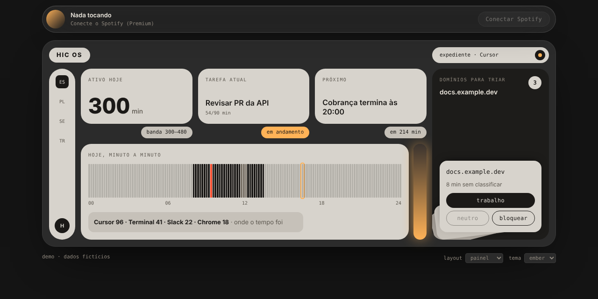
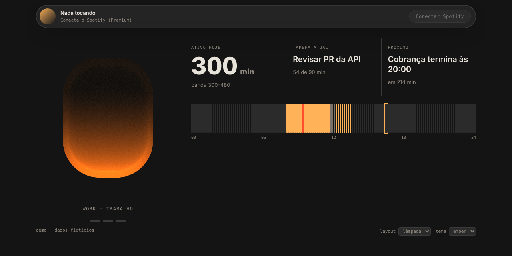

# HIC OS

Um painel de foco para quem trabalha na frente do computador. Ele mede o que você realmente fez (não o quanto a tela ficou ligada),
cobra de volta quando você sai do trabalho e manda parar quando você passa do ponto. Código aberto, MIT.

| Painel | Lâmpada |
|---|---|
|  |  |

*Capturas do modo demo, com dados fictícios.*

## A ideia

- **Medir, não supor.** Cada minuto é classificado como trabalho, distração, tela parada, ausente ou sem classificar.
  No classificador em TypeScript, tela aberta e parada por 10 minutos ou mais vira `IDLE` e não conta como trabalho.
  O `hic.py` ainda conta esses minutos; a correção chega com a porta do daemon.
- **Banda, não meta.** Um piso e um teto por dia. Passar do teto também é um desvio.
- **Cobrança escalonada.** Notificação, voz, e só então Focus Mode forçado. Depois das 22h o sistema empurra para fora do trabalho.
- **Privacidade primeiro.** Domínios privados são descartados antes de qualquer registro; nunca chegam ao log.
- **Temas.** Um tema é um bloco de variáveis CSS. Primeiro `ember` e `mono`; japonês, clean, techno e cyberpunk estão previstos.

## Status

Está em transição de um daemon em Python para um sistema em TypeScript. O que funciona hoje:

| Parte | Onde | Estado |
|---|---|---|
| Interface (Next.js, Tailwind, Framer Motion, R3F) | [`web/`](web) | Roda em modo demo. Lê dados reais se um daemon responder em `/api/state`. |
| Player do Spotify | [`web/`](web) | Código escrito, **ainda não testado com conta real** (exige Premium). |
| Classificador em TypeScript | [`core/`](core) | Pronto, com testes de paridade contra o `hic.py`. |
| Daemon (captura do macOS, cobrança, logs) | [`hic.py`](hic.py) | Funciona em Python. A porta para TypeScript ainda não começou. |
| Instalador | | **Não está no repositório.** Veja [`docs/daemon-python.md`](docs/daemon-python.md). |
| Demo na Vercel | | Ainda não publicada. |

## Início rápido (interface em modo demo)

```bash
git clone https://github.com/PAVincius/hic-os.git
cd hic-os/web
npm install
npm run dev        # http://127.0.0.1:3000
```

Para ver dados reais, rode o daemon (`python3 hic.py`, veja [`docs/daemon-python.md`](docs/daemon-python.md)) e sirva a interface na mesma origem.
Detalhes de temas, layouts, Spotify e Vercel em [`web/README.md`](web/README.md).

## Testes

```bash
cd core && npm install && npm test
```

O teste de paridade roda milhares de sondas pelo `classify_from` do `hic.py` e exige resultado idêntico no TypeScript.
Para regenerar as sondas: `python3 core/scripts/gen_parity.py`.

## Estrutura

```
web/    interface (Next.js)
core/   classificador em TypeScript e testes
hic.py  daemon atual (Python, sem dependências, macOS)
docs/   documentação do daemon e imagens
```

## Contribuindo

Issues e PRs são bem-vindos. Os defaults de configuração devem ser genéricos: nada específico de uma pessoa ou empresa.
Licença: [MIT](LICENSE).
